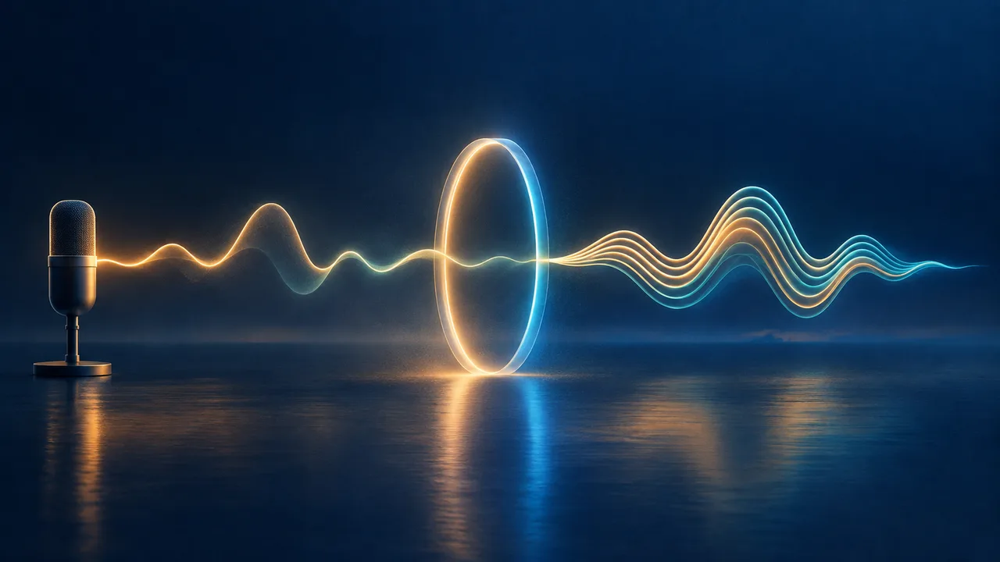

# AI Voice Cloning Skill

[English](./README.md) | [简体中文](./README.zh-CN.md) | 日本語

> 👉 こちらもどうぞ [AI Voiceover Generator Skill](https://github.com/beatra-ai/ai-voiceover-generator-skill)

クリアな音声サンプルから再利用できる自分やブランドの声を作り、覚えやすい名前を付け、短いテスト読みで確認。Claude Code、Cursor、Codex、Windsurf、Cline、OpenClaw のどれからでもそのまま使えます。

> [!IMPORTANT]
> 生成には [Beatra](https://beatra.ai?utm_source=github&utm_medium=flagship&utm_campaign=ai-voice-cloning-skill) アカウントが必要で、クレジットを消費します。スキル自体のインストールは無料です。

| 項目 | 内容 |
| --- | --- |
| **できること** | クリアな音声サンプルから再利用できる自分やブランドの声を作り、名前を付けて短い原稿で明瞭さ、テンポ、語調を試せます。 |
| **モデル** | MiniMax Voice Clone、MiniMax Speech 2.8 HD、MiniMax Speech 2.8 Turbo、Doubao Seed TTS 2.0、ElevenLabs v4 Turbo、ElevenLabs v4 |
| **動作要件** | Python 3.10 以上と、`SKILL.md` を読み込めるエージェント |
| **費用** | インストールは無料。生成のたびに Beatra アカウントのクレジットを消費しますが、課金されるのは、その生成を明示的に依頼したとき、または確認カードを承認したときだけです。 |
| **対応エージェント** | Claude Code、Cursor、Codex、Windsurf、Cline、OpenClaw |

<p align="center"></p>

*1 本の声の波形がリングを通り抜け、再利用できる重なった声として戻ってくる抽象的なカバー。Beatra AI で生成。*

| Skill | Entry point | Version |
| --- | --- | --- |
| [`voice-cloning-studio`](skills/voice-cloning-studio) | [SKILL.md](skills/voice-cloning-studio/SKILL.md) | 0.3.1 |

このリポジトリは [beatra-ai/beatra-skills](https://github.com/beatra-ai/beatra-skills/tree/main/skills/voice-cloning-studio) から自動的に公開されています。問題の報告はそちらへお願いします。

このスキルは `ai-voice-cloning` としても知られています（インストール名：`voice-cloning-studio`）。

## インストール

[`skills`](https://skills.sh) CLI を使う場合：

```bash
npx skills add beatra-ai/ai-voice-cloning-skill
```

Claude Code プラグインとして：

```bash
claude plugin marketplace add beatra-ai/ai-voice-cloning-skill
claude plugin install voice-cloning-studio@ai-voice-cloning-skill
```

Codex プラグインとして：

```bash
codex plugin marketplace add beatra-ai/ai-voice-cloning-skill
codex plugin add voice-cloning-studio@ai-voice-cloning-skill
```

GitHub Copilot CLI プラグインとして：

```bash
copilot plugin marketplace add beatra-ai/ai-voice-cloning-skill
copilot plugin install voice-cloning-studio@ai-voice-cloning-skill
```

Gemini CLI 拡張機能として：

```bash
gemini extensions install https://github.com/beatra-ai/ai-voice-cloning-skill
```

Antigravity CLI プラグインとして：

```bash
agy plugin install https://github.com/beatra-ai/ai-voice-cloning-skill
```

GitHub CLI を使う場合：

```bash
gh skill install beatra-ai/ai-voice-cloning-skill voice-cloning-studio
```

または、このリポジトリをクローンして `skills/voice-cloning-studio` を次の場所にコピーします：Claude Code は `~/.claude/skills/`、Cursor は `~/.cursor/skills/`、Codex は `~/.agents/skills/`、Windsurf は `~/.codeium/windsurf/skills/`、Cline は `~/.cline/skills/`、OpenClaw は `~/.openclaw/skills/`。

または、次の文をエージェントに貼り付けてください：

```text
https://github.com/beatra-ai/ai-voice-cloning-skill から voice-cloning-studio スキル（フォルダ skills/voice-cloning-studio）をインストールし、その SKILL.md に従って私の Beatra アカウントに接続してください。
```

クリーン環境で動作確認済み：Antigravity CLI (2026-11-09)。

## 作例

<p align="center"></p>

[▶ 試聴する（MP3）](assets/sample.mp3)

*23 秒の合成プリセットボイスの読み上げ（冒頭 8 秒を収録）を Harbor Narrator という再利用可能なカスタムボイスにクローンし、その新しい声で 11 秒のテスト読みをしたもの。Beatra AI で生成。*

エージェントへの依頼例：

```text
./harbor-sample.mp3 の声を Harbor Narrator という名前の再利用できるボイスにクローンして、その声でこのテスト文を読んで：「The lighthouse keeps its own hours, and so does the tide.」
```

プロンプト：

```text
Source script: Every harbor town keeps its own kind of morning. The fishing boats slip out before sunrise, the gulls argue over the pier, and the café on the corner props its door open to let the bread smell drift toward the water. By eight o'clock, the tide has turned, the ferry horn sounds twice, and the whole waterfront settles into an easy, unhurried rhythm.

Test reading script: Hello, and welcome back to the Lantern Lane course. In today's lesson, we'll plan a simple weekly routine, one small step at a time. Let's begin.
```

## 入力と出力

| | 種類 | 形式 | 仕様 |
| --- | --- | --- | --- |
| **入力** | 音声：自分の声かブランドの声の、1人が話すクリアな録音 | MP3、WAV | 10〜300 秒／1 ファイル最大 20 MB |
| **入力** | テキスト：ボイスの表示名と、任意の試聴用の一文 | — | — |
| **出力** | 音声：新しい名前付きボイスで読んだ短い試聴（ボイスは後のナレーションに使えます） | MP3 | — |

## 技術仕様と出力上限

2026-11-14 時点。最新の一覧：https://docs.beatra.ai/ja/docs/models

- **アップロード** — 1 ファイルあたり最大 100 MB。下記の各モデルの入力制限も適用されます
- **ボイスクローン** — 1 モデル（MiniMax Voice Clone）／サンプル 10〜300 秒、最大 20 MB／本人の同意確認が必要
- **音声合成** — 5 モデル（MiniMax Speech 2.8 HD、MiniMax Speech 2.8 Turbo、Doubao Seed TTS 2.0、ElevenLabs v4 Turbo、ElevenLabs v4）／FLAC、MP3、OPUS、PCM、WAV／40 言語／サンプルレート 8、16、22.05、24、32、44.1 kHz／1 リクエストあたり最大 50000 文字
  - 言語（ISO 639 コード）：zh, yue, en, es, fr, ru, de, pt, ar, it, ja, ko, id, vi, tr, nl, uk, th, pl, ro, el, cs, fi, hi, bg, da, he, ms, fa, sk, sv, hr, fil, hu, no, sl, ca, nn, ta, af

## 得られるもの

- **クリアなサンプルで声の土台を作る** — 一人の自然な話し声、少ない背景ノイズ、弱い反響、代表的な語調を選び、再利用しやすい声を作ります。
- **見分けやすい名前を付ける** — 作成した声にわかりやすい名前を付け、今後のエピソード、講座、お知らせのナレーションで選びやすくします。
- **短い原稿で聞いてから広げる** — 準備ができたら短い読み上げで明瞭さ、テンポ、語調を確認してから、本格的な音声制作に進めます。

## 活用シーン

- **クリエイターの定番ナレーター** — チャンネルの導入、解説、エピソード更新、連載コンテンツに、ひとつの親しみのある声を使います。
- **創業者・ブランドの声** — クリアなサンプルから名前のある声を作り、製品ストーリー、お客様向けのお知らせ、社内アナウンスに使えます。
- **講座・コミュニティの案内役** — レッスン、歓迎メッセージ、プログラムのお知らせを、ひとつの聞き慣れた声でつなげます。

## よくある質問

### ボイスクローンに適した録音とは？

1人が自然に話す10〜300秒の録音で、声が明瞭で、背景ノイズと反響が少なく、今後のナレーションで出したい語調のものです。

### 録音で避けることは？

音楽、別の話者、強い反響、大きな背景ノイズです。

### 後から同じボイスを使えますか？

はい。名前付きのボイスは残り、今後のナレーションに使えます。新しい原稿や話し方も、そのボイスで読み上げます。

### 作成したボイスはどう試聴できますか？

指定した短い一文を MP3 で読み上げるので、明瞭さ、発音、テンポ、語調を聞けます。

## 更新とセキュリティ

2026 年 10 月のリリース以降、このスキルに自動更新機能はありません。インストールしたファイルだけを実行し、
自動的に置き換えることはありません。更新はインストールに使ったツール（`npx skills update voice-cloning-studio` または
`gh skill update voice-cloning-studio`）で行ってください。詳細はスキル内の `references/updates-and-security.md` を参照してください。

## ライセンス

このリポジトリのスキルファイル（`SKILL.md`、リファレンス、スクリプト）とこの README は [MIT-0](LICENSE) で提供しています。商用を含め、自由に使用・改変・再配布でき、クレジット表記は不要です。

生成は Beatra のクラウドサービスで行われ、[Beatra 利用規約](https://beatra.ai/terms?utm_source=github&utm_medium=flagship&utm_campaign=ai-voice-cloning-skill)が適用されます。

## リンク

- スキルページ — https://beatra.ai/skills/voice-cloning-studio?utm_source=github&utm_medium=flagship&utm_campaign=ai-voice-cloning-skill
- ウェブサイト — https://beatra.ai?utm_source=github&utm_medium=flagship&utm_campaign=ai-voice-cloning-skill
- ドキュメント — https://docs.beatra.ai?utm_source=github&utm_medium=flagship&utm_campaign=ai-voice-cloning-skill
- コンソール — https://console.beatra.ai
- AI エージェント向け — https://beatra.ai/llms.txt （インデックス）· https://beatra.ai/llms-full.txt （全スキルを 1 ファイルに）
