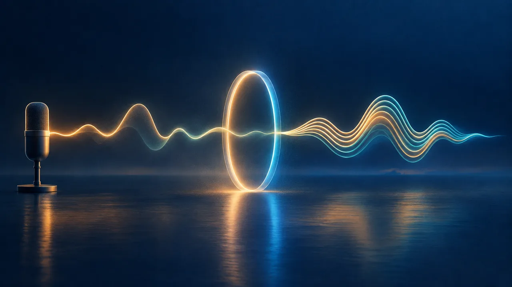
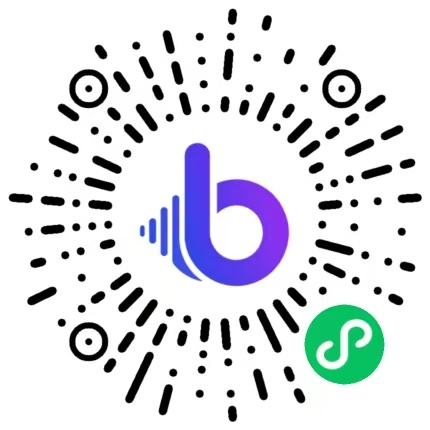

# AI Voice Cloning Skill

[English](./README.md) | 简体中文 | [日本語](./README.ja.md)

> 👉 也看看 [AI Voiceover Generator Skill](https://github.com/beatra-ai/ai-voiceover-generator-skill)

用干净的语音样本创建可复用的个人或品牌声音，为音色命名，并通过短句试听清晰度、节奏与语气，在 Claude Code、Cursor、Codex、Windsurf、Cline 或 OpenClaw 里直接完成。

> [!IMPORTANT]
> 生成需要 [Beatra](https://beatra.ai?utm_source=github&utm_medium=flagship&utm_campaign=ai-voice-cloning-skill) 账号并消耗积分，安装本身不收费。

| 问题 | 回答 |
| --- | --- |
| **能做什么** | 用干净语音样本创建可复用的个人或品牌声音，为音色命名，并通过短句试听清晰度、节奏与语气。 |
| **底层模型** | MiniMax Voice Clone、MiniMax Speech 2.8 HD、MiniMax Speech 2.8 Turbo |
| **运行要求** | Python 3.10+，以及能加载 `SKILL.md` 的 Agent |
| **费用** | 安装免费。每次生成消耗 Beatra 账号积分，只有你明确要求这次生成或批准确认卡后才会付费。 |
| **支持的 Agent** | Claude Code、Cursor、Codex、Windsurf、Cline、OpenClaw |

<p align="center"></p>

*抽象封面：一条人声波形穿过光环，化作可重复使用的多层声线。由 Beatra AI 生成。*

| Skill | Entry point | Version |
| --- | --- | --- |
| [`voice-cloning-studio`](skills/voice-cloning-studio) | [SKILL.md](skills/voice-cloning-studio/SKILL.md) | 0.3.1 |

本仓库由 [beatra-ai/beatra-skills](https://github.com/beatra-ai/beatra-skills/tree/main/skills/voice-cloning-studio) 自动发布，问题请到那里反馈。

## 安装

使用 [`skills`](https://skills.sh) CLI：

```bash
npx skills add beatra-ai/ai-voice-cloning-skill
```

作为 Claude Code 插件：

```bash
claude plugin marketplace add beatra-ai/ai-voice-cloning-skill
claude plugin install voice-cloning-studio@ai-voice-cloning-skill
```

作为 Codex 插件：

```bash
codex plugin marketplace add beatra-ai/ai-voice-cloning-skill
codex plugin add voice-cloning-studio@ai-voice-cloning-skill
```

作为 GitHub Copilot CLI 插件：

```bash
copilot plugin marketplace add beatra-ai/ai-voice-cloning-skill
copilot plugin install voice-cloning-studio@ai-voice-cloning-skill
```

作为 Gemini CLI 扩展：

```bash
gemini extensions install https://github.com/beatra-ai/ai-voice-cloning-skill
```

作为 Antigravity CLI 插件：

```bash
agy plugin install https://github.com/beatra-ai/ai-voice-cloning-skill
```

使用 GitHub CLI：

```bash
gh skill install beatra-ai/ai-voice-cloning-skill voice-cloning-studio
```

也可以克隆本仓库，把 `skills/voice-cloning-studio` 复制到 `~/.claude/skills/`（Claude Code）、`~/.cursor/skills/`（Cursor）、`~/.agents/skills/`（Codex）、`~/.codeium/windsurf/skills/`（Windsurf）、`~/.cline/skills/`（Cline）或 `~/.openclaw/skills/`（OpenClaw）。

或者把下面这段话发给你的 Agent：

```text
从 https://github.com/beatra-ai/ai-voice-cloning-skill 安装 voice-cloning-studio skill（目录 skills/voice-cloning-studio），然后按它的 SKILL.md 连接我的 Beatra 账号。
```

## 效果示例

<p align="center"></p>

[▶ 试听（MP3）](assets/sample.mp3)

*用一段 23 秒的合成预设音色朗读（此处截取前 8 秒）克隆出名为 Harbor Narrator 的可复用自定义音色，随后是用新音色做的 11 秒试读。由 Beatra AI 生成。*

在你的 Agent 里这样说：

```text
把 ./harbor-sample.mp3 里的声音克隆成一个可以反复使用的音色，命名为 Harbor Narrator，然后用它读这句测试词：“The lighthouse keeps its own hours, and so does the tide.”
```

提示词：

```text
Source script: Every harbor town keeps its own kind of morning. The fishing boats slip out before sunrise, the gulls argue over the pier, and the café on the corner props its door open to let the bread smell drift toward the water. By eight o'clock, the tide has turned, the ferry horn sounds twice, and the whole waterfront settles into an easy, unhurried rhythm.

Test reading script: Hello, and welcome back to the Lantern Lane course. In today's lesson, we'll plan a simple weekly routine, one small step at a time. Let's begin.
```

## 输入与输出

| | 类型 | 格式 | 规格 |
| --- | --- | --- | --- |
| **输入** | 音频：一段单人清晰录音，是你自己或品牌的声音 | MP3、WAV | 10–300 秒；单个文件最大 20 MB |
| **输入** | 文本：音色名称，以及可选的一句试听文案 | — | — |
| **输出** | 音频：用新音色读的一段短试听，音色保留用于之后的旁白 | MP3 | — |

## 技术规格与输出限制

截至 2026-10-18。实时列表：https://docs.beatra.ai/zh/docs/models

- **上传** — 单个文件最大 100 MB；同时适用下方各模型的输入限制
- **声音克隆** — 1 个模型（MiniMax Voice Clone）；样本 10–300 秒，最大 20 MB；需提交授权声明
- **语音合成** — 2 个模型（MiniMax Speech 2.8 HD、MiniMax Speech 2.8 Turbo）；FLAC、MP3、OPUS、PCM、WAV；40 种语言；采样率 8、16、22.05、24、32、44.1 kHz；单次最多 50000 字符
  - 语言（ISO 639 代码）：zh, yue, en, es, fr, ru, de, pt, ar, it, ja, ko, id, vi, tr, nl, uk, th, pl, ro, el, cs, fi, hi, bg, da, he, ms, fa, sk, sv, hr, fil, hu, no, sl, ca, nn, ta, af

## 为什么用 Beatra，而不是直接调用模型 API

- **一个账号用到本 skill 的全部模型** — 声音克隆 1；语音合成 2（MiniMax Voice Clone、MiniMax Speech 2.8 HD、MiniMax Speech 2.8 Turbo）（截至 2026-10-18），一次 Beatra 登录即可使用，不必分别管理各家模型的 key。
- **花不花钱由你决定** — 只有你明确要求这次生成，或批准显示实时积分估算的确认卡后才会付费。
- **先策划，再生成** — skill 先帮你规划、指导和检查，再在 Beatra 上生成。
- **文件可以核验** — `skills/` 下的每个文件都与 cdn.beatra.ai 上的发布归档逐字节一致，每次推送前用 SHA-256 校验。
- **更新由你掌控** — 不含自更新程序；用安装时的工具更新。
- **在你的 Agent 里运行** — Claude Code、Cursor、Codex、Windsurf、Cline、OpenClaw。

## 你能得到什么

- **干净样本带来更好的声音起点** — 选择单人自然说话、背景安静、回声较少且语气有代表性的录音，方便创建更实用的可复用音色。
- **给声音取一个认得出的名字** — 为成功创建的音色命名，之后为节目、课程和更新选择旁白时更容易找到它。
- **先听短句，再决定下一步** — 准备好时，用一段简短口播检查清晰度、节奏和语气，再用到更大的内容项目里。

## 适用场景

- **创作者的固定旁白** — 为频道开场、讲解视频、节目更新和系列内容保留一个熟悉的个人声音。
- **创始人或品牌声音** — 用干净样本创建有名字的音色，用于产品故事、客户更新和内部通知。
- **课程与社群主持人** — 让课程讲解、欢迎词和活动更新都由同一个熟悉的声音表达。

## 常见问题

### 什么样的录音适合声音克隆？

一个人自然说话、10 到 300 秒、声音清楚、背景噪音低、回声少，语气接近以后旁白想要的感觉。

### 录音里要避开什么？

音乐、其他人声、明显回声和很重的背景噪音。

### 以后还可以继续使用这个音色吗？

可以。这个有名字的音色会保存下来，之后的新文案和不同的读法都能用它来读。

### 怎样试听刚做好的音色？

用你给的一句短文案读一段 MP3 试听，听清晰度、读音、节奏和语气。

## 更新与安全

自 2026 年 10 月的版本起，本 skill 不再包含自更新程序：它只运行你安装的文件，从不自行替换。
请用安装时的工具更新——`npx skills update voice-cloning-studio` 或 `gh skill update voice-cloning-studio`。
详见 skill 内的 `references/updates-and-security.md`。

## 许可证

本仓库的 Skill 文件（`SKILL.md`、参考文档和脚本）与本 README 采用 [MIT-0](LICENSE) 许可：可自由使用、修改和再分发，包括商用，无需署名。

内容生成在 Beatra 云端完成，适用 [Beatra 服务条款](https://www.beatra.cn/terms?utm_source=github&utm_medium=flagship&utm_campaign=ai-voice-cloning-skill)。

## 相关链接

- 官网 — https://www.beatra.cn?utm_source=github&utm_medium=flagship&utm_campaign=ai-voice-cloning-skill
- 文档 — https://docs.beatra.cn?utm_source=github&utm_medium=flagship&utm_campaign=ai-voice-cloning-skill
- 控制台 — https://console.beatra.cn
- 给 AI Agent 读的说明 — https://www.beatra.cn/llms.txt （索引）· https://www.beatra.cn/llms-full.txt （全部 skill 合成一个文件）

- 微信小程序 — 国内用户微信扫码使用


